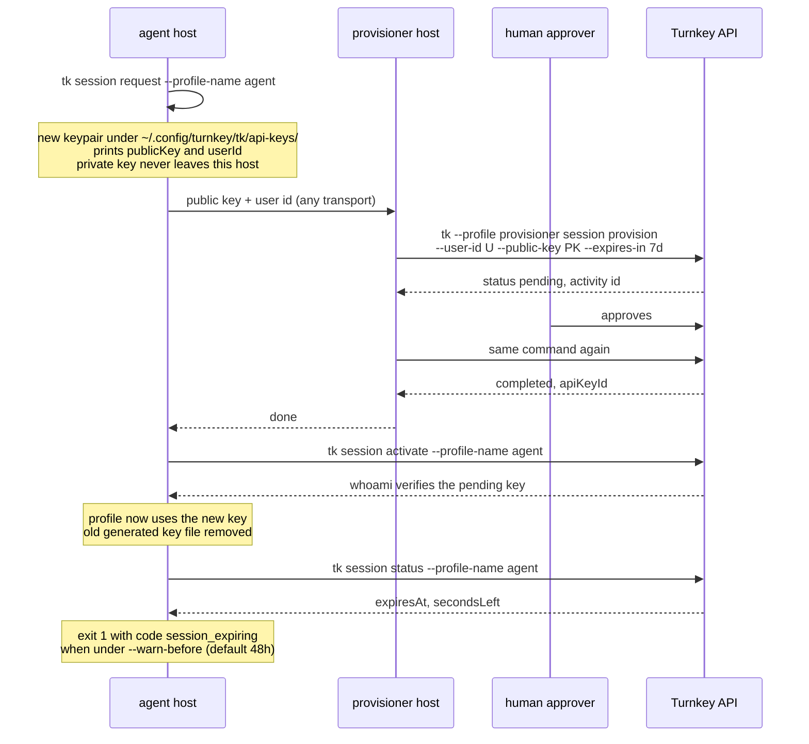

# Session keys

A session key is a Turnkey API key with an expiration. `tk session` splits its
lifecycle so that the private key never leaves the machine that uses it and the
identity allowed to register keys never sees it.

Follow [authentication](./authentication.md) first.



## Request

```bash
tk session request --profile-name agent
tk session request --profile-name agent --replace   # drop an unregistered request
```

The profile must already exist. The request is remembered under
`~/.config/turnkey/tk/sessions/pending/<profile>.json` until `activate` uses it.
`userId` is read with the profile's current credential and is `null` only when
that credential is no longer authorized; pass the user id to the provisioner
by other means then. Any other lookup failure, such as a rate limit or a
network error, fails the command before it generates a key, so it can be rerun.

## Provision

```bash
tk --profile provisioner session provision --user-id USER_UUID --public-key PK --expires-in 7d
```

Runs as the provisioner and submits `CREATE_API_KEYS_V2` with
`expirationSeconds`. The record always shows `userId`, `expiresIn`, and
`publicKey` so an approver can check them. If the key is already registered on
that user the command reports it with `alreadyRegistered: true` and submits
nothing, so re-running after approval is safe.

Durations take `s`, `m`, `h`, or `d` suffixes, from `1s` to `365d`.

## Activate

```bash
tk session activate --profile-name agent
```

Verifies the pending key with `whoami`, then repoints the profile at it. Until
the key is registered the command fails with `unauthorized` and the profile is
unchanged. A previous key file is deleted only if `tk` generated it under
`~/.config/turnkey/tk/api-keys/`.

## Status

```bash
tk session status --profile-name agent
tk session status --profile-name agent --warn-before 24h
```

Looks up the profile's key on its user and reports `expiresAt` (unix ms),
`secondsLeft`, and `expiresIn`. A key without expiration reports `null` for
those and always exits 0. Inside the warning window the command exits 1 with
code `session_expiring` and the same fields under `details`, which makes it
usable as a cron check.

## Policies

The provisioner needs an ALLOW policy on `ACTIVITY_TYPE_CREATE_API_KEYS_V2`,
usually with a consensus expression that also requires a human approver. The
agent needs a DENY on `activity.resource == 'CREDENTIAL'`; without it Turnkey
lets a user register keys on itself by default, and a short-lived key could
mint a permanent one. Policies see each key's `expiration_seconds` under
`activity.params.api_keys`, so the provisioner's ALLOW can cap the lifetime; a
key without expiration reads as the maximum. The target user's tags are not
visible, so the approver checks the target from the record.

## Skills

- [deploying-signing-broker](../skills/deploying-signing-broker/SKILL.md): place the signing broker and its session provisioner in separate containers.
- [sidecar-patterns](../skills/sidecar-patterns/SKILL.md): where each command runs in a deployment and the renewal state machine around them.
- [provisioning-session-agent](../skills/provisioning-session-agent/SKILL.md): the operator procedure, approval cell, renewal, and recovery around these four commands.
